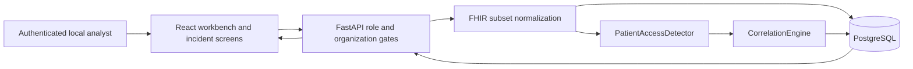

# Investigation platform architecture and API

## Current components and boundaries

The earlier platform is already present on main; this candidate adds the bounded case/import/rerun workbench to that architecture. Current software/API is 1.1.0 and rule version is `clinical-access-1.1`. Checked-in code is not deployment or security approval. [The workbench guide](docs/WORKBENCH.md) is the complete current browser contract.

| Component | Actual responsibility |
|---|---|
| `platform/local.py` | Loopback module, trusted dashboard mount, migrations and local account seed; separate from deployment ASGI bootstrap |
| `platform/api.py`, `auth.py`, `body_limit.py` | HTTP bounds/headers, Argon2id and legacy hash verification, PyJWT, DB principal/token-version resolution, roles, scoped data routes |
| `platform/workbench.py` | Bounded source/config parsing, canonical clinical detection/correlation, immutable report/delta construction |
| `platform/connectors/fhir_auditevent.py` | Supported R4 AuditEvent subset and counted per-entry errors; no invented missing action/outcome/timezone |
| `platform/db.py`, `repository.py`, `migrations/` | PostgreSQL models, scoped persistence, idempotency/concurrency and versioned migrations |
| `platform/ingestion.py`, `correlation.py`, `investigation.py` | Separate normalized-event ingestion, deterministic grouping, incident state/actions/history |
| `platform/provenance.py` | App/rule/core revisions, Python source-content hash and exact tracked checkout or UNKNOWN |
| `dashboard-ui/` | Actual authenticated React/TypeScript application, static esbuild bundle; no Vite dev-server requirement |

The ORM defines ten tables: users, security_events, detection_findings, incidents, incident_findings, incident_events, investigation_actions, rule_versions, workbench_cases and workbench_runs. The case/run migration is `b2c3d4e5f6a7`, following the token-version and audit-chain migrations. It stores original input text and report JSON; database owners remain trusted. A downgrade drops the case/run tables and is not automatic recovery.

## Routes and authority

| Route group | Contract |
|---|---|
| `/health`, `/readiness` | Unauthenticated liveness/provenance and DB check; readiness can return 503 |
| POST `/api/v1/auth/token` | Username/password JSON → bearer token, role and organization; generic failures and per-process throttle |
| `/api/v1/workbench/sample`, `/cases`, `/cases/{case_id}`, `/cases/{case_id}/runs`, `/cases/{case_id}/runs/{run_id}/export` under the workbench prefix | Authenticated synthetic sample, org-scoped import/list/history/rerun/checksummed export; full method/body table in the workbench guide |
| POST `/api/v1/events` | Separate normalized clinical batch ingestion; writer role |
| POST `/api/v1/connectors/fhir/auditevent` | Separate legacy connector ingestion; writer role; not the case/run API |
| GET `/api/v1/incidents` and `/{incident_id}` with evidence/timeline/history/export | Organization-scoped incident queries for authorized roles |
| Incident assign/notes/disposition/close POST and status PATCH | Writer-role actions and state/concurrency checks |

`administrator` and `security_analyst` can ingest/write; `read_only_auditor` can inspect permitted data. Foreign objects are concealed with 404; missing/invalid/revoked tokens return 401 and disallowed roles 403. Token role/org claims alone do not authorize current access: the server resolves the DB row and token version. CORS is an explicit allowlist, not authentication. OpenAPI is described at `/openapi.json`; the restrictive API documentation CSP can prevent an interactive Swagger page, so do not assume `/docs` is a usable browser client.

Workbench reports retain original/normalized records, findings, related-event links, correlated incident IDs, uncertainty, source/config/input hashes and versions. Per-run IDs/timestamps vary; input/configuration hashes and semantic expected signals support reproduction. Related-event links are batch actor context, not causal proof for every linked event. The internal investigation hash chain is not an external tamper-proof journal.

## Separate deployment and verification

The local script uses a dedicated loopback PostgreSQL 17 development volume. `deploy/docker-compose.yml` is a separate configuration with its own PostgreSQL image, mandatory DB/signing secrets, unpublished DB, loopback dev ports and backend least-privilege controls. The ASGI `platform.server` calls secure-config validation only when `AEGIS_REQUIRE_SECURE_CONFIG=1`; the Compose environment enables it. Do not infer this gate is always active in arbitrary programmatic `create_app()` use.

[RUNBOOK.md](RUNBOOK.md) explains lifecycle, private state, diagnostics and rollback. [THREAT_MODEL.md](THREAT_MODEL.md) maps tested boundaries and remaining risk. [EVIDENCE.md](docs/EVIDENCE.md) separates historical 212/280-test milestone records, published 8ae implementation-source evidence and pending later documentation-head execution. A restart/persistence test is not a production backup/restore, clean-machine or hosted CI approval.
