# Aegis HealthSec — Security Investigation Workbench

A local investigation tool for security analysts reviewing bounded synthetic FHIR R4 AuditEvent files. Import JSON, inspect actual detector/correlation evidence persisted in PostgreSQL, change a case threshold, rerun the same retained dataset and export a checksummed report. The React application calls the authenticated FastAPI backend and canonical clinical detector; outcomes are not mock findings.

**Software/API 1.1.0 · rules clinical-access-1.1 · release decision PARTIAL.** This is offline batch investigation, not continuous monitoring, proof of malicious access, full FHIR validation, anonymization or HIPAA approval. Use synthetic data only; original JSON is retained. No provider keys, paid services or cloud resources are required.

## Try the real engine in your browser

[**Open the free Colab notebook**](https://colab.research.google.com/github/poojakira/attack-detection-engine/blob/codex/local-workbench-20261116/notebooks/try_product.ipynb) · [Inspect the notebook source](notebooks/try_product.ipynb) · [Detailed architecture diagrams](docs/ARCHITECTURE.md)

Sign in with a Google account, select the **free CPU runtime**, and run the setup and scenario cells. Change the scenario and run again to inspect freshly computed evidence and hashes. This is an inline, guided synthetic-data demonstration of the actual repository engine, **not a publicly hosted copy of the full web application**. No API key, paid plan, GPU, Drive mount, tunnel or cloud-resource creation is used by the notebook. Free Colab availability/limits are outside this repository's control.

The setup resolves the reviewed branch to one exact SHA, checks it out and installs only minimal demo dependencies in a separate temporary environment. It starts no web server. [Testing access and limitations](docs/TRY_IT.md) distinguishes locally executed notebook checks from Colab-hosted runtime verification. Use the full local UI below for its broader supported input and workflow.

## Architecture

[](docs/architecture/overview.svg)

See the [detailed architecture and execution sequences](docs/ARCHITECTURE.md) for exact code symbols, controls, limits, errors, cleanup, evidence and the separate guided notebook scope.

## Start locally

Prerequisites: Python 3.12, Node 22 or newer, npm, Docker, a browser, free loopback ports 8000/55432 and internet access for initial dependency/image downloads. From the repository root:

```sh
./scripts/local-workbench.sh
```

Open http://127.0.0.1:8000 and sign in as `local-analyst` using the password entered at startup. This development account is seeded with the administrator role in the local investigation organization. Existing accounts retain their password; relaunching does not reset it. The script creates a dedicated local PostgreSQL container/volume, installs package dependencies, builds React and applies migrations. The core revision is immutable, but this is not a complete transitive/OS image lock or a clean-machine certification. See [operations and alternate-port startup](RUNBOOK.md).

## Complete an investigation

1. Select **Load synthetic sample → Import and investigate**. The 30-event fixture produces `HC-ACCESS-BULK` at threshold 25.
2. Expand a finding and timeline event to inspect original source, normalized metadata, related persisted events, uncertainty and correlated incident.
3. Set **Distinct patient read threshold** to 40 and select **Rerun same dataset**. The retained dataset is reevaluated; the finding delta removes one signal.
4. Select **Export reproducible report**. The client verifies the report SHA-256 before downloading. Export is disabled while changed input/configuration lacks a current run.
5. Reload, select the saved investigation and review both runs. Stop with Ctrl-C; the dedicated database volume and private password file are retained. Restart requires signing in again.

The sample is a controlled regression fixture, not a field accuracy benchmark. Reference extraction does not establish de-identification. Do not import real PHI or secrets.


## Verification and release scope

**LOCAL ONLY, historical snapshot.** The archived suite at `aa45efd2f9f7e229a0ae7b7f8d77adac18d96e83` recorded 332 passed, 0 failed, 0 skipped, 82.47% line coverage. The archive was generated on November 19, 2026 UTC and lists the exact commands, tooling, test window, skips and artifact hashes. Use its source SHA when citing the results. [Manifest](https://raw.githubusercontent.com/poojakira/attack-detection-engine/875299dd6a7ed061df792d1150371c688383fc05/release-evidence/manifest.json) · [Assessment](https://github.com/poojakira/attack-detection-engine/blob/875299dd6a7ed061df792d1150371c688383fc05/release-evidence/RELEASE_ASSESSMENT.md)

Main contains the earlier FHIR, authentication, persistence and React platform. The saved investigation, threshold rerun and checksummed export workflow is in the draft candidate. Synthetic batch evaluation cannot establish clinical authorization, production privacy or recovery. [Draft review](https://github.com/poojakira/attack-detection-engine/pull/58)

## Documentation index

| Task | Guide |
|---|---|
| Product scope, real browser workflow, architecture, API, tests and limitations | [Workbench](docs/WORKBENCH.md) |
| Startup/shutdown, state, diagnostics, CLI and rollback | [Runbook](RUNBOOK.md) |
| Current platform components and API boundaries | [Platform](PLATFORM.md) |
| Clinical rules, context and data privacy | [Healthcare](HEALTHCARE_SECURITY.md) |
| Separate offline CAN/C/C++/ARM analysis | [Automotive](AUTOMOTIVE_SECURITY.md) |
| Threats and vulnerability reporting | [Threat model](THREAT_MODEL.md), [security](SECURITY.md) |
| Verification, branch recovery and promotion | [Evidence](docs/EVIDENCE.md), [validation](PRODUCT_VALIDATION.md), [release gates](PRODUCTION.md) |
| Authorized development and all-document review | [Contributing](CONTRIBUTING.md), [documentation audit](docs/DOCUMENTATION_AUDIT.md) |

Main already contains the earlier FHIR, clinical, correlation, auth, persistence and React platform. Older branch-only claims are historical. The case/rerun workflow is in this reviewed candidate; automotive/firmware/ARM browser integration remains unimplemented. Dated reports retain their original source scope, with external/operational assertions unverified where recorded. No default-branch merge, public deployment or software release is included.

## Selected branches and recovery

Only `main` and `codex/local-workbench-20261116` remain as remote branches. This cleanup retired 12 additional branches after preserving their exact tips in `archive/selected-20261118/*` annotated recovery tags and a verified private Git bundle. Unmerged/dependency changes were **not merged or certified** by retiring their branches. Existing release/deployment source references are preserved separately. Main was not rewritten or merged.

See [branch policy and restore procedure](docs/BRANCHES.md) and the generated [branch-cleanup evidence](https://github.com/poojakira/attack-detection-engine/blob/875299dd6a7ed061df792d1150371c688383fc05/release-evidence/cleanup.json). Bots or collaborators may create later branches; the published report records the actual verification time rather than promising permanent branch counts.
