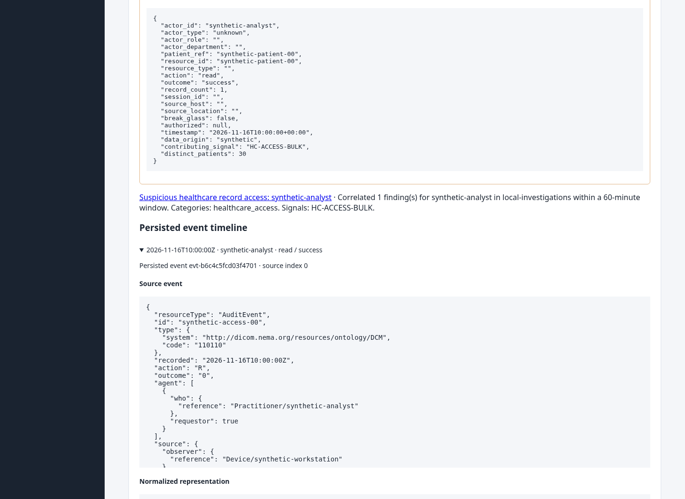

# Aegis HealthSec — Security Investigation Workbench

A local investigation tool for security analysts reviewing bounded synthetic FHIR R4 AuditEvent files. Import JSON, inspect actual detector/correlation evidence persisted in PostgreSQL, change a case threshold, rerun the same retained dataset and export a checksummed report. The React application calls the authenticated FastAPI backend and canonical clinical detector; outcomes are not mock findings.

**Software/API 1.1.0 · rules clinical-access-1.1 · release decision PARTIAL.** This is offline batch investigation, not continuous monitoring, proof of malicious access, full FHIR validation, anonymization or HIPAA approval. Use synthetic data only; original JSON is retained. No provider keys, paid services or cloud resources are required.

## Start locally

Prerequisites: Python 3.12, Node 22 or newer, npm, Docker, a browser, free loopback ports 8000/55432 and internet access for initial dependency/image downloads. From the repository root:

```sh
./scripts/local-workbench.sh
```

Open http://127.0.0.1:8000 and sign in as `local-analyst` using the password entered at startup. This development account is seeded with the administrator role in the local investigation organization. Existing accounts retain their password; relaunching does not reset it. The script creates a dedicated local PostgreSQL container/volume, installs package dependencies, builds React and applies migrations. The core revision is immutable, but this is not a complete transitive/OS image lock or a clean-machine certification. See [operations and alternate-port startup](RUNBOOK.md).

## Complete an investigation

1. Select **Load synthetic sample → Import and investigate**. The 30-event fixture produces `HC-ACCESS-BULK` at threshold 25.
2. Expand a finding and timeline event to inspect original source, normalized metadata, related persisted events, uncertainty and correlated incident.
3. Set **Distinct patient read threshold** to 40 and select **Rerun same dataset**. The retained dataset is reevaluated; the finding delta removes one signal.
4. Select **Export reproducible report**. The client verifies the report SHA-256 before downloading. Export is disabled while changed input/configuration lacks a current run.
5. Reload, select the saved investigation and review both runs. Stop with Ctrl-C; the dedicated database volume and private password file are retained. Restart requires signing in again.

The sample is a controlled regression fixture, not a field accuracy benchmark. Reference extraction does not establish de-identification. Do not import real PHI or secrets.



This screenshot and the published implementation proof attest to source `8ae9090b560871d1e584d717734693bb570fffae`, not a later documentation commit. That run recorded 327 passed, zero skipped/failed/errors and 82.47% line coverage under the unchanged 53% gate. Its 18 focused independent observations closed AEGIS-QA-01. Hosted CI remained queued/NOT VERIFIED. Later-head checks are pending until an actual generated manifest identifies that head; see [evidence status](docs/EVIDENCE.md) and [PR #58](https://github.com/poojakira/attack-detection-engine/pull/58). No production approval follows from these results.

## Documentation index

| Task | Guide |
|---|---|
| Product scope, real browser workflow, architecture, API, tests and limitations | [Workbench](docs/WORKBENCH.md) |
| Startup/shutdown, state, diagnostics, CLI and rollback | [Runbook](RUNBOOK.md) |
| Current platform components and API boundaries | [Platform](PLATFORM.md) |
| Clinical rules, context and data privacy | [Healthcare](HEALTHCARE_SECURITY.md) |
| Separate offline CAN/C/C++/ARM analysis | [Automotive](AUTOMOTIVE_SECURITY.md) |
| Threats and vulnerability reporting | [Threat model](THREAT_MODEL.md), [security](SECURITY.md) |
| Verification, branch recovery and promotion | [Evidence](docs/EVIDENCE.md), [validation](PRODUCT_VALIDATION.md), [release gates](PRODUCTION.md) |
| Authorized development and all-document review | [Contributing](CONTRIBUTING.md), [documentation audit](docs/DOCUMENTATION_AUDIT.md) |

Main already contains the earlier FHIR, clinical, correlation, auth, persistence and React platform. Older branch-only claims are historical. The case/rerun workflow is in this reviewed candidate; automotive/firmware/ARM browser integration remains unimplemented. Dated reports retain their original source scope, with external/operational assertions unverified where recorded. No default-branch merge, public deployment or software release is included.
