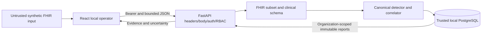

# Aegis threat model

## Assets and trust boundaries

Assets are original event JSON, normalized metadata, source/configuration provenance, organization-scoped cases/incidents, login state, private database configuration and exported reports. The local analyst and operator host are trusted; supplied JSON/metadata/IDs and browser requests are untrusted. A reference token or a successful record parse does not prove authorization, de-identification or absence of malicious access.

The deployment operator also controls bootstrap credentials, signing secret, migrations, database permissions, build artifacts, TLS/ingress and backup/retention. A compromised host/database can forge locally stored evidence. An unkeyed hash chain/checksum does not create an external trust anchor.

## Threat/control/evidence map

| Threat | Checked-in control and source/test relationship | Residual risk |
|---|---|---|
| Forged, disabled or stale identity | `platform/auth.py` and API login/principal resolution; `test_platform_auth_hardening.py`, tenant tests | Secret/host/database trust; in-memory login limiter resets; deployment secret management and SSO unverified |
| Auditor writes or foreign object reads | Authoritative role checks, org-scoped case/incident queries; `test_workbench.py`, `test_platform_tenant_isolation.py` | No claim of every future endpoint or externally managed tenant integration |
| Malformed/oversized/slow JSON | `body_limit.py` actual received-byte/deadline enforcement; workbench UTF-8/entry/config bounds and tests | Parser/detector in API process; bounded input is not a hard execution sandbox or full FHIR validation |
| Cross-site/framing/rendering abuse | Host allowlist, explicit CORS, restrictive CSP/security headers, escaped React output; web-security and real browser tests | Trusted local origin/operator; no hostile public-hosting assessment |
| Invented clinical observations | FHIR connector keeps missing optional action/outcome UNKNOWN, requires explicit timezone, counts rejected entries; schema/detector/connector/workbench tests | Supplied records/context may be false; no clinical authorization or malicious-intent proof |
| Conflicting imports/reruns or forged success | Atomic transactions, case row lock/latest-run check, source-content identities and actual stored reports | Advisory case-count race; provider/external effects outside scope |
| Stale browser findings/list/export | Input/revision and shared list sequence guards, checksum validation; `scripts/browser-workbench.py` QA01 and async regressions | A cancelled request can already have committed; reload to reconcile |
| Sensitive content in retained data | Normalized schema rejects some obvious identifiers; originals deliberately retained; synthetic-only instructions and evidence checks | No anonymization proof; exports/backups/database may contain identifiers or arbitrary supplied fields |
| Audit/report alteration | Checksummed canonical exports, investigation hash chain and verification tests | DB owner can rewrite reports/chain; no external anchor, signed attestation or immutable external custody |
| Resource/storage exhaustion | Per-process rate/concurrency and case/run limits in API; bounded input and query pagination | Restart/multiprocess quotas, storage capacity and coordinated enforcement not proven |
| Dependency/container compromise | Immutable core ref, lock snapshots, dependency/SAST/workflow gates and source-scoped artifacts | Mutable tooling/base images, shared kernel, optional image runtime and deployment-specific controls require fresh review |

Tests establish their named cases at their recorded source, not universal security. See [exact-source evidence](docs/EVIDENCE.md) for actual results and blocked checks.

## Separate offline and dataset surfaces

The NDJSON CLI parses supplied telemetry and returns findings; it is not a collector, packet firewall or automated responder. CAN parsing does not transmit frames; C/C++ pattern checks and ARM ELF structures do not execute supplied source/firmware or prove exploitability. Care relationships from an optional MIMIC dataset are context, not authorization grants. Dataset licenses, provenance, privacy and access approval remain operator responsibilities; no dataset is needed for the synthetic workbench task.

## Release blockers

Full FHIR conformance, hard parser/detector isolation/deadline, coordinated multiprocess quotas, externally anchored audit integrity, clean-machine/image provenance, representative accuracy/load evidence, production backup/restore, SSO/TLS/secret operations and deployment/privacy approval remain incomplete or unverified. The current hosted-run limitation is recorded as observed statuses/errors, not inferred from an old Actions-disabled claim. No production or HIPAA approval is implied.
