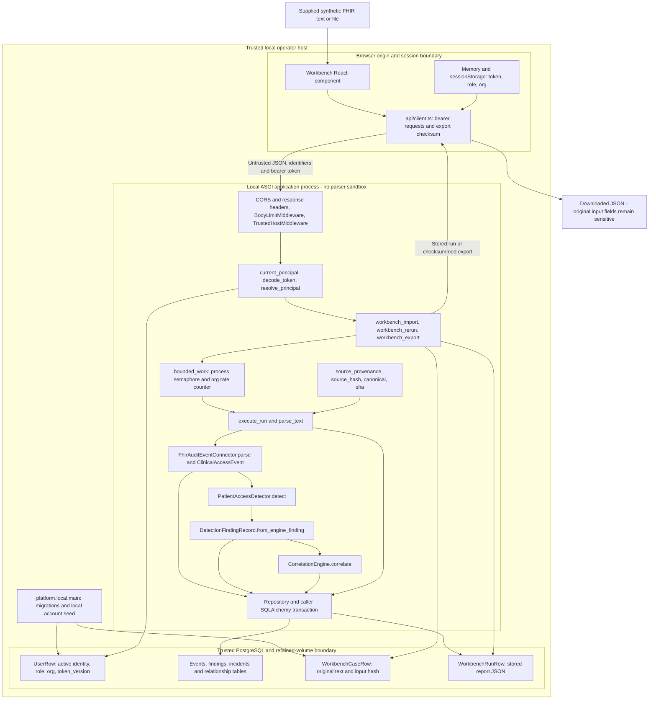
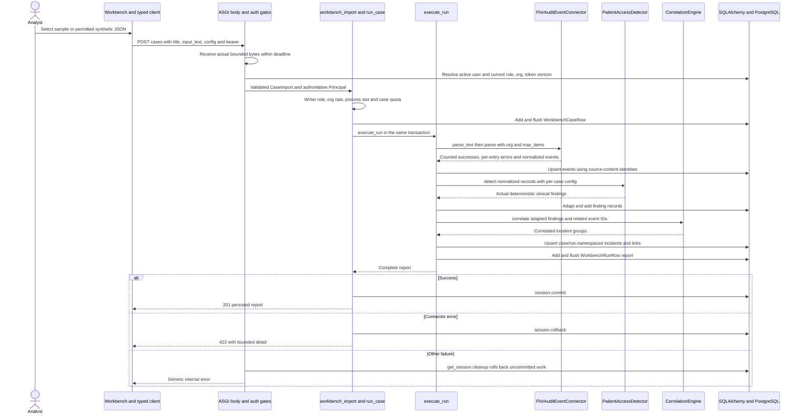
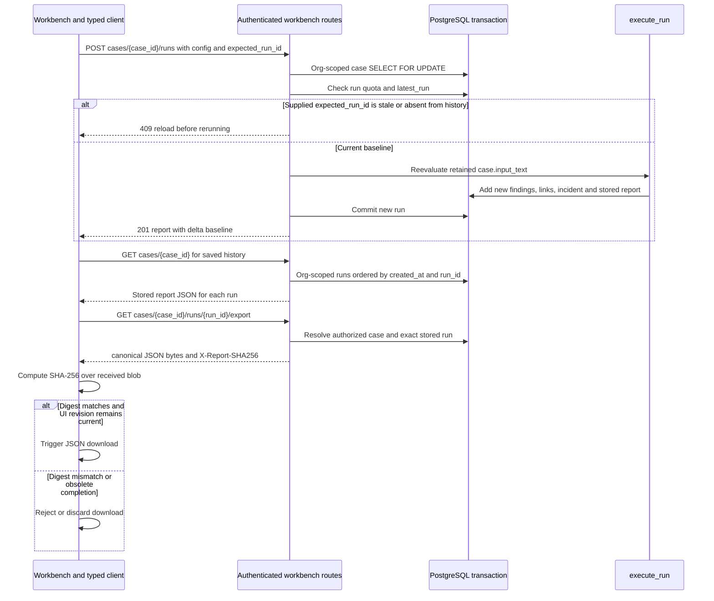

# Aegis architecture and execution boundaries

This guide maps the current local investigation implementation and the separate guided notebook adapter. It is a source review, not a new runtime, hosted-kernel, security or release certification. Software/API is `1.1.0`, rules are `clinical-access-1.1`, and the core reference is `087accffc7d9ba7e2c086b9ef72ef7ac6f23c29b`. Exact candidate execution and limitations belong to the generated [evidence](EVIDENCE.md). The release remains PARTIAL.

## Components and trust boundaries

The component diagram groups responsibilities rather than representing every call. [Local startup](../detection_engine/platform/local.py) mounts a trusted prebuilt dashboard and applies migrations before serving loopback. It seeds a local administrator, not a read-only user. The shell launcher owns the separate local PostgreSQL container/volume and private password file. It is distinct from the deployment `platform.server` entrypoint and optional Compose configuration. See [operations](../RUNBOOK.md) for their prerequisites and lifecycle.

`create_app()` in [api.py](../detection_engine/platform/api.py) registers application middleware so ordinary requests enter CORS → `SecurityMiddleware` → `BodyLimitMiddleware` → `TrustedHostMiddleware` → routing/dependencies. Framework error wrappers surround that stack, and CORS preflight can return early. Response-header middleware applies CSP, no-store, no-referrer, framing and content-type controls to responses traversing it. CORS and allowed Host values are request boundaries, not authentication or an execution sandbox. The diagram does not imply that every framework-generated error traverses every application middleware.

The browser and supplied metadata are untrusted across the API boundary. The operator controls the Python process, signing secret, trusted build and database. PostgreSQL ownership is therefore an evidence trust assumption: a host/DB owner can rewrite records. Loopback binding does not establish safe public hosting, clinical privacy approval or tenant isolation beyond the actual scoped queries.

## Authentication and authority

[client.ts](../dashboard-ui/src/api/client.ts) sends username/password JSON to `POST /api/v1/auth/token`, then keeps the token in memory and mirrors token/role/org into sessionStorage. Those browser role/org values are presentation state, not server authority. `login()` uses `LoginThrottle`, active `UserRow`, password verification and optional successful-login legacy-hash migration. New hashes use Argon2id. [auth.py](../detection_engine/platform/auth.py) uses PyJWT with HS256 allowlisting, issuer/audience, expiry/issued-at validation and required custom identity/role/org claims.

For each authenticated data request, `current_principal()` decodes the bearer token, loads `UserRow` by subject and calls `resolve_principal()`. Missing/inactive users and stale token versions fail. The resolved role and organization come from the current DB row. The resolver does not simply trust token claims or require a separate literal comparison of token role/org to DB role/org. Changes can take effect through authoritative DB values and token-version revocation. `Principal.can_ingest()` permits administrators and security analysts to import/rerun. Read-only auditors can inspect/export their organization's cases. Case and run queries bind organization to this principal, with 404 for missing/foreign objects. Requests never select their organization through case JSON.

Local ephemeral signing secrets invalidate previous process tokens at restart. SessionStorage is accessible to JavaScript at its origin and is not an HttpOnly cookie or a secret vault. It must never be copied into public evidence. Deployment secrets, SSO and public-hosting controls require separate review.

## Import, engine execution and commit

[BodyLimitMiddleware.__call__](../detection_engine/platform/body_limit.py) reads actual ASGI chunks before JSON parsing, rather than trusting Content-Length. The default `MAX_BODY_BYTES` is 2 MiB, configurable through `AEGIS_MAX_BODY_BYTES`. A first over-limit chunk produces 413 before storage in the chunk list. One 15-second `anyio.fail_after` covers total body receipt, producing 408. **This is not a deadline for JSON parsing, detector CPU, SQL or a complete investigation.** Bounded bodies are assembled in memory inside the API process.

[CaseImport, CaseConfig and parse_text](../detection_engine/platform/workbench.py) add a 1 MiB UTF-8 source limit, 1,000 source entries before filtering, title length 1–160, strict integer bulk threshold 2–1000 and denial-streak threshold 2–100. Unknown config fields fail. JSON escaping means the HTTP envelope can exceed source text length. `bounded_work()` allows two concurrent investigations per process and 30 attempted work requests/minute/organization. Case/run limits are 100/organization and 20/case. These counters are not coordinated across workers, and case-count checks can race concurrent imports.

[FhirAuditEventConnector](../detection_engine/platform/connectors/fhir_auditevent.py) accepts a single AuditEvent, list or Bundle metadata subset, with counted rejected entries. It requires zoned `recorded` time with seconds, optional fractions, and object agents. Missing optional action/outcome stays UNKNOWN. Failure levels are not invented authorization denials. `ClinicalAccessEvent` validation rejects selected invalid/obvious-identifier patterns but does not prove anonymization. There is no full FHIR R4 schema/conformance validator. An empty usable result is an error, not a clean scan.

`execute_run()` stores original per-entry source and normalized metadata, assigns source-content identity using `sha(canonical(resource))`, and delegates event persistence to `Repository.upsert_event()`. Dedup is scoped by organization and event dedup key. Reusing a FHIR ID with changed source content therefore does not silently replace the new record with an old event. A new `PatientAccessDetector` receives this case's config and optional context. The normal workbench supplies no authoritative assignment/shift context, so findings explicitly retain that uncertainty. Denial-streak threshold changes cannot supply denial semantics absent from this R4 mapping.

Findings pass through `DetectionFindingRecord.from_engine_finding()` with their source event time used for correlation. `CorrelationEngine._bucket_key()` groups by **organization, identity (or resource fallback) and fixed time bucket**, default one hour. Categories describe the resulting incident/key and maximum contributing severity sets its severity. The implementation does not require matching host/session or multiple categories to group these findings, and the time bucket is not a rolling session window. Workbench incident correlation keys additionally include case ID and run ID, keeping rerun incidents distinct. Related-event links include actor-based batch context, not proof that each event caused the finding.

`Repository` flushes inside the caller transaction and does not independently commit these workbench writes. `run_case()` commits after `execute_run()` completes. Connector errors explicitly roll back. Other failures propagate to the generic error boundary while `get_session()` rolls back remaining uncommitted work and closes the session. The request can commit before a client abort/disconnect becomes visible, so cancellation is not transaction cancellation or guaranteed undo.

## Rerun, history and export

Case/rerun concurrency uses `load_case(lock=True)`, a case-row lock and `latest_run()` ordered by descending `(created_at, run_id)`. `CaseRerun.expected_run_id` must equal that latest report, including when a user selected an older historical run. This is separate from incident `row_version`: `Repository.update_incident(expected_version=...)` supports a version check and increment for incident updates, not the workbench's baseline-run protocol or a universal compare-and-swap guarantee for every client action.

Run reports are stored as new [WorkbenchRunRow](../detection_engine/platform/db.py) rows. Delta uses a Counter of fingerprints over rule/identity/resource, so multiplicity matters. “Unchanged” counts matching fingerprints, not equality of every evidence field. Events in reports are ordered by normalized event timestamp and source index. History uses creation time/run-ID ordering, not HTTP response arrival order. API routes provide no report-edit operation, but a DB owner can still alter stored rows.

[Workbench](../dashboard-ui/src/screens/Workbench.tsx) has two distinct ordering guards. `revision` and `invalidate()` invalidate old sample/file/run/history/export completions and abort pending fetches. `upload()` invalidates before asynchronous `File.text()` returns. Configuration changes retain the prior report but disable export until a matching rerun. `download()` snapshots the selected run and discards results after revision change or abort. Separately, `refreshCases()` uses `caseListSequence` and `mounted` guards for both success and failure, preventing a late initial case list from overwriting a newer post-import list. Unmount increments guards and aborts pending work. These are stale-UI defenses, not guarantees that aborted server work never committed.

`workbench_export()` loads authorized stored JSON and applies `canonical()` with sorted keys, compact separators and `ensure_ascii=False`. `sha()` hashes UTF-8 bytes and returns `X-Report-SHA256`. `client.exportRun()` recomputes SHA-256 with Web Crypto before download. This is an integrity comparison against the serving endpoint, not a signature, independent attestation or external audit anchor.

## Provenance, privacy and retained state

Reports contain input/config hashes, app/rule/core versions, installed dependency versions, source commit/clean status, Python source-content hash, timestamps, original/normalized events, findings, related links, correlated incidents, delta and limitations. [source_provenance()](../detection_engine/platform/provenance.py) checks the exact tracked Git root, returning UNKNOWN outside it rather than inheriting unrelated enclosing Git history. `source_hash()` hashes Python path/content pairs under `detection_engine`; it is not a hash of all UI, docs, dependencies, images or runtime state. UUIDs, timestamps and report bytes may differ across executions even when semantic signals and input/config hashes match.

`WorkbenchCaseRow.input_text` retains the entire submitted original text, including unsupported/rejected source entries. Reports include source JSON for accepted entries. Identifier extraction/heuristics do not remove arbitrary identifying fields from originals. **Never infer PHI-free, anonymous, compliant or authorized-to-process from a successful import.** This evaluation accepts synthetic data only. Only exact parsed equality with the first-party sample earns the trusted synthetic label, otherwise origin is unspecified.

Cases, runs, events, findings and incidents persist in the dedicated PostgreSQL volume across application/container restart. Browser tokens, private DB password/configuration, backups and source inputs must not enter public evidence. No automatic retention/purge, privacy classifier or production backup/restore guarantee exists. Case-to-run FK uses cascade deletion, but that is not a supported privacy deletion workflow for all related data. Migration downgrade can drop case/run tables and requires an explicitly reviewed data-loss/backup plan. Preserve the paired private password file and retained product volume. See [runbook](../RUNBOOK.md), [threat model](../THREAT_MODEL.md) and [healthcare boundaries](../HEALTHCARE_SECURITY.md).

Missing controls include hard parser/detector process isolation and execution deadline, complete FHIR conformance, authoritative clinical authorization/context, representative accuracy/load evidence, coordinated multiprocess quotas, externally anchored audit integrity, SSO/production secret/ingress operations and exercised production recovery/privacy approval. Existing limits and checks do not close those gaps.

## Separate guided notebook engine preview

```mermaid
flowchart LR
  NB["notebooks/try_product.ipynb: inline scenario controls"] --> Runner["demo/notebook_runner.py: fixed scenario and checkout metadata"]
  Runner --> Adapter["demo/adapter.py: run and evaluate"]
  Adapter --> Sample["platform.sample.synthetic_sample"]
  Sample --> FHIR["FhirAuditEventConnector.parse"]
  FHIR --> HC["PatientAccessDetector.detect"]
  HC --> Adapt["DetectionFindingRecord.from_engine_finding"]
  Adapt --> Corr["CorrelationEngine.correlate"]
  Corr --> JSON["In-memory JSON evidence and report checksum"]
  JSON --> NB
```

The [adapter](../demo/adapter.py) calls real connector/detector/correlator code on the fixed 30-event first-party synthetic sample. `run()` accepts only `threshold25`, `threshold40` or `compare`. `evaluate()` labels the fixed organization `synthetic-notebook-demo`, constructs normalized events/findings/incidents in memory and returns sample hash, config, counts and selected evidence. Compare checks that both configurations used the same input hash. It does **not** call the SQLAlchemy repository, create accounts, use the API authentication path, save cases/runs, exercise HTTP body middleware or provide the full React workbench. Its JSON schema/checksum encoding is separate from the full workbench report/export contract.

The [runner](../demo/notebook_runner.py) selects this checkout's adapter and records source commit plus CLEAN/DIRTY or UNKNOWN, times and limitations. Its outer checksum uses sorted compact JSON with default ASCII escaping and rejects NaN. The [notebook](../notebooks/try_product.ipynb) resolves the selected remote branch once, fetches/checks out that SHA, creates a separate temporary venv, installs minimal notebook requirements and invokes the runner with a 60-second subprocess timeout. The timeout is on that preview subprocess, not a parser sandbox or a full API execution deadline. Public source/package downloads still require network access during setup.

Normal inline notebook output starts **no HTTP server, tunnel, background service, database or external deployment**. It requests no provider API key, paid resource, Drive mount, arbitrary upload or real PHI. A Google account and an available free session are prerequisites for the Colab interface. **Colab-hosted kernel execution remains NOT VERIFIED** unless fresh environment-specific evidence establishes it. Source review, local runner success and an opening notebook link cannot certify the hosted runtime. See [try-it boundaries](TRY_IT.md) and the actual candidate manifest.

## Review and verification map

| Boundary | Source/test evidence to execute at the frozen candidate |
|---|---|
| Actual received bytes/deadline and clinical/input semantics | `tests/test_workbench.py`, connector and schema tests |
| DB-backed auth, roles and org scope | Auth-hardening, tenant-isolation, API and workbench tests |
| Transactional persistence, rerun conflicts and export | Workbench/PostgreSQL integration and installed-wheel checks |
| UI ordering, stale initial list and checksummed download | `scripts/browser-workbench.py` against real Chromium/API/PostgreSQL |
| Guided stateless synthetic preview | `tests/test_notebook_demo.py` and locally executed scenario cells, separately from hosted Colab |
| Diagram syntax and actual rendered layout | Parent architecture-render artifacts, not implied by this source review |

This guide adds no test result or hosted-pass claim. Full exact-head checks, diagram rendering, evidence publication and independent release assessment remain separately recorded actions.
