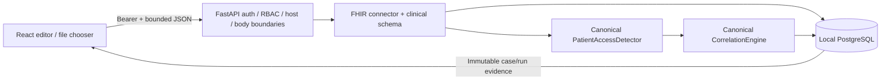

# Local Security Investigation Workbench 1.1.0

## Product and acceptance scope

An analyst imports bounded FHIR R4 AuditEvent JSON, inspects a persisted access timeline and real deterministic clinical findings, changes a case threshold, reruns the exact dataset, and exports an immutable evidence report. This is an offline batch investigation tool. It does not establish malicious intent, authorization, clinical correctness, anonymization, or continuous monitoring. Only synthetic data is permitted in this evaluation.

The local browser workflow reuses the existing React application, authenticated FastAPI, PostgreSQL repository, `PatientAccessDetector`, finding adapter and `CorrelationEngine`. Automotive CAN, firmware and ARM CLI paths remain separate; browser integration of those paths is NOT IMPLEMENTED. Full operational signoff, exhaustive historical-document reconciliation, remote branch protection and publication remain PARTIAL.

Acceptance: the 30-event first-party synthetic sample yields the canonical `HC-ACCESS-BULK` signal at threshold 25. Rerunning its exact input at 40 removes that signal. Both runs, original source events, normalized representations, linked persisted events/incidents, configuration/input/source hashes, versions and uncertainty remain inspectable after a page reload. This fixture is not a field accuracy benchmark.

## Launch and use

Prerequisites: Python 3.12, Node 22 or newer, npm, Docker, available loopback ports 55432 and 8000, and internet access for the initial dependency/image installation. No provider keys, paid services or cloud resources are required. From the repository root:

```sh
./scripts/local-workbench.sh
```

The launcher creates a dedicated PostgreSQL 17 container/volume, stores its random local password in `.aegis-local/db-password` (mode 0600), installs the pinned Python dependencies and React build, applies Alembic migrations and prompts for an initial analyst password. Open `http://127.0.0.1:8000`, sign in as `local-analyst`, and use that password. On subsequent launches the existing account retains its password; the prompt does not reset accounts. Startup duration depends on package downloads. Ctrl-C stops the API and dedicated container; the volume retains evidence. Process signing secrets are not persisted, so restarting requires signing in again.

1. Select **Load synthetic sample**, or select a synthetic FHIR JSON file / paste permitted synthetic JSON.
2. Select **Import and investigate**. Read normalized and rejected counts. Expand a finding and a timeline event to compare original source, normalized metadata, related events, rule, uncertainty and supporting evidence. The incident link opens the existing investigation/status/note workflow.
3. Change **Distinct patient read threshold** from 25 to 40; select **Rerun same dataset**. This uses the server-retained exact dataset, not the editor contents. Export is disabled while a changed configuration is pending.
4. Inspect the finding delta and switch run history. Changing configuration from an older run requires reloading the current case: stale reruns return 409 rather than overwrite a newer run.
5. Select **Export reproducible report**. The client checks SHA-256 against the server header before downloading. Editing input, selecting a file, starting a scan, switching runs, or leaving the screen cancels obsolete download completion. Cancelling a request does not undo an already committed transaction; reload saved cases to reconcile.
6. Reload the page, select **Saved investigation**, and verify that both reports remain available. Login tokens are held in memory/sessionStorage and are never part of reports.

For a separately installed wheel, build the dashboard with `npm ci && npm run build` in `dashboard-ui`, set `AEGIS_DATABASE_URL` to an isolated local PostgreSQL database, then run:

```sh
python -m detection_engine.platform.local --dashboard /absolute/path/to/dashboard-ui/dist
```

The wheel contains the migration scripts/configuration; the React build is a separately supplied trusted artifact. It reports source commit `UNKNOWN` outside its exact tracked source Git root, and still reports source-content hashes. Do not attribute an enclosing repository's HEAD to the wheel.

## Supported input and corrected semantics

Supported JSON shapes: one object with `resourceType: AuditEvent`, a JSON list, or a Bundle whose `entry` array contains resources. Limits: 1 MiB UTF-8 input; 1,000 source entries before filtering; 2 MiB received HTTP body (JSON escaping can make the envelope larger); 15-second total body-receive deadline. Unsupported Bundle resources and non-object list entries count as rejected, rather than silently disappearing. Zero usable events returns an error. Mixed input reports per-entry rejection indexes and sanitized reasons.

This is a security metadata subset, not full FHIR R4 schema/conformance validation. It requires a resource discriminator, an explicit timezone-bearing second-resolution `recorded` instant and at least one object agent. Optional R4 `action`/`outcome` may be absent: they become `unknown` through the clinical schema and detector. Present unsupported/non-string codes are rejected. Outcomes 0/4/8/12 map to success/minor/serious/major failure; they do not infer authorization denials. Unsupported timestamp formats are rejected; a missing timezone is never invented by the FHIR adapter. The separate legacy normalized clinical API retains its documented naive-UTC timestamp convention.

References are extracted as tokens, not anonymized. The clinical schema rejects obvious email/SSN/bare long-number identifiers but cannot establish de-identification. The workbench deliberately retains original JSON, which can contain fields excluded from normalized metadata; never import real PHI or secrets. Only a dataset exactly matching the first-party generated sample receives `synthetic`; uploads and edits receive `unspecified` unless they exactly reproduce that trusted sample.

## Architecture and decisions



Original input and configuration are separate from normalized observations and findings. The API derives organization from the verified principal and rechecks the authoritative user/token-version row. Case/run queries scope by organization, using 404 to conceal foreign objects. Read-only roles can inspect/export their organization's cases but cannot import/rerun. ORM statements bind data; React renders input as text without raw HTML.

A new per-case detector instance receives only two bounded integers: distinct-patient threshold [2,1000] and denial-streak threshold [2,100]. No file, URL, command, module or executable expression is configurable. The R4 subset does not infer `denied`, so the denial-streak control has no effect unless supported explicit denial context becomes available; the current FHIR sample demonstrates only the bulk-read threshold. There is no global policy mutation. Reruns lock the case row and require the latest run ID. Whole runs commit atomically; detector/parser failure rolls back case/events/findings/incidents rather than returning green output.

Case/run reports are immutable rows. Source records deduplicate by organization and canonical source-content hash, so reusing an upstream FHIR ID with changed content does not substitute an old event. Correlation uses event time, and persisted incident keys include case and run to avoid unrelated rerun merging. Related-event links are actor-based batch context, not proof that every related event caused the finding. Delta fingerprints identify rule/actor/resource signals; counts detect additions/removals, not a proof that every evidence field is unchanged.

Decision: preserve PostgreSQL and canonical engines; add bounded case/run tables via migration `b2c3d4e5f6a7`. Keep React, replace Vite's vulnerable glob/plugin dependency chain with static esbuild plus TypeScript checking. There is no browser dev server or runtime compilation in the launch path. Clinical imports are lazy with respect to optional STIX tooling; the full ATT&CK engine remains available for separately verified CLI/platform paths. `attack-v19-core` remains pinned to `087accffc7d9ba7e2c086b9ef72ef7ac6f23c29b` and verified v19.2 bundles.

## API contract

All data routes require a current bearer token from `POST /api/v1/auth/token` with `{username,password}`. The existing Argon2id hashing, legacy verification, brute-force throttle, role checks, revocation and organization isolation remain. Health returns version, rule/core revision and exact-source provenance. Readiness checks PostgreSQL; database failure is 503 with no connection-string detail.

| Method / route | Body / result |
| --- | --- |
| GET `/api/v1/workbench/sample` | Trusted synthetic JSON text and descriptive label |
| POST `/api/v1/workbench/cases` | `{title,input_text,config:{bulk_access_threshold,denial_streak_threshold}}`; 201 immutable first report |
| GET `/api/v1/workbench/cases` | Latest 100 case IDs/titles scoped to organization |
| GET `/api/v1/workbench/cases/{case_id}` | Persisted immutable run reports |
| POST `/api/v1/workbench/cases/{case_id}/runs` | `{config,expected_run_id}`; 201 new report, 409 for stale baseline |
| GET `/api/v1/workbench/cases/{case_id}/runs/{run_id}/export` | Canonical JSON attachment plus `X-Report-SHA256` |

401 means invalid/missing/revoked token; 403 disallowed role; 404 missing/foreign case/run; 408 body deadline; 409 stale run/quota; 413 byte/entry limit; 422 invalid input/config; 429 busy/rate limit; 500 internal failure without exception detail. No success result is produced on detector failure. Existing `/api/v1/incidents` evidence/timeline/history/actions/export and `/api/v1/connectors/fhir/auditevent` remain available; their raw clinical/connector ingestion is a separate legacy interface.

## Threat model and operations

Assets: source event JSON, organization boundaries, login state, immutable reports and database integrity. Threats: malicious JSON/metadata, forged/cross-org identifiers, parser exhaustion, brute force, stale UI requests, conflicting reruns and misleading detection conclusions. Controls: actual received-byte/time limits before JSON parsing; strict bounded configs; loopback binding; host allowlist; explicit CORS; restrictive CSP and escaped React rendering; role/token-version checks; per-process two-run concurrency and 30 requests/minute/org; at most 100 cases/org and 20 runs/case; atomic transactions; generic errors and checksummed exports.

Residual risks: source input can contain PHI/secrets and is retained; no full FHIR validation, parser sandbox or privacy classification; detector CPU has bounded input but no separate hard worker kill deadline; process rate limits reset on restart and do not coordinate across processes; case quota counts are advisory under concurrent imports; reports/history and stored data are not externally tamper-proof; database owner can alter reports; no external audit anchor, SSO, backup automation or production operations signoff. Local PostgreSQL credentials are development-only. No public deployment is authorized.

Retention is explicit: raw input, normalized events, findings/incidents and run reports persist in the dedicated volume until the owner removes it. Before deletion, export permitted reports and stop the API. To erase only the launcher-owned workspace, stop/remove `aegis-local-workbench-postgres`, remove `aegis-local-workbench-data`, and remove `.aegis-local` after confirming no data is needed. Never run schema-dropping tests against this retained database. Backups/restores and multi-user production retention are NOT VERIFIED.

Migrations are applied before serving. For rollback stop the API, take an owner-approved backup, downgrade only the newest migration if discarding case/run data is intended, and restore the prior package. Existing event/incident tables are retained by that migration downgrade. Do not automatically downgrade a real database. API/DB failures require inspection and retry; browser cancellation can leave a committed case visible on reload.

## Testing, evidence and security autopsy

`tests/test_workbench.py` invokes the real detector and PostgreSQL: unknown/malformed R4 semantics, major failures, mixed-entry counts, streamed/lying-length/chunked size bounds, receive deadline, atomic failure, config bounds, cross-org/role/forged/revoked tokens, persisted reruns/export/restart and content-conflicting source IDs. `scripts/browser-workbench.py` uses real Chromium/API/PostgreSQL and synthetic inputs: import/evidence, threshold delta/export, saved-case reload, obsolete export checksum, delayed File.text versus later edit, XSS-shaped metadata, malformed JSON and mobile layout. The browser harness also holds the first real case-list response across a successful import, then releases it and requires the newly saved case to remain selectable (AEGIS-QA-01). Every list refresh uses its own shared monotonic request sequence for success/error callbacks and unmount invalidation; this sequence is independent of editor changes. The browser harness does not log credentials/storage or weaken the product CSP.

Run prerequisites: a disposable PostgreSQL test database, complete platform dependencies, verified ATT&CK bundles in `ATTACK_DATA_DIR` and writable native HOME for optional `stixmarx` tooling (it writes `~/.stixmarx`). Do not change a managed read-only HOME. Use a nonroot isolated runtime with writable tmpfs at its existing HOME if needed. Clinical-only workbench imports do not load STIX tooling. Full tests drop all ORM tables; never target retained/user data.

```sh
python -m pip install -e '.[platform]' -r requirements.lock
ruff check .
ruff format --check .
pyright --pythonpath /path/to/venv/bin/python detection_engine
pytest tests --cov=detection_engine --cov-fail-under=53 --junitxml=/outside/source/junit.xml
npm --prefix dashboard-ui ci
npm --prefix dashboard-ui run build
pip check
pip-audit
npm --prefix dashboard-ui audit
bandit -r detection_engine -ll
python -m build --outdir /outside/source/packages
python scripts/browser-workbench.py --evidence /outside/source/browser
```

Set both `AEGIS_DATABASE_URL` and `AEGIS_TEST_DATABASE_URL` to the same explicitly disposable DB for tests, using test-only credentials. Tests needing PostgreSQL/ATT&CK historically skip if prerequisites are missing; final evidence must identify skips individually, not count them as passes. Native pytest subtest outcomes must be counted separately from testcase outcomes. All final commands, UTC intervals/exits, JUnit/coverage, audits, browser reports/screenshots/JSON export, artifact hashes and source cleanliness belong to an out-of-tree manifest generated after freezing the candidate commit. CI uses actual checkout provenance; no workflow hardcodes its own source SHA.

Security autopsy: the old FHIR connector and clinical adapter invented READ/SUCCESS and a timezone. That could manufacture bulk-access findings; UNKNOWN now survives all adapters and only explicit READ+SUCCESS counts. Non-object/unsupported entries were silently dropped; every source entry now has a counted outcome. The old middleware read an unlimited body before measuring it; bounded ASGI receive now rejects the first over-limit chunk before storing it and uses a total deadline. Existing tests expecting invented success were corrected with explicit UNKNOWN assertions; valid FHIR fixtures now include their discriminator. The former Vite/React Router pins had known advisories; the new static bundler and compatible framework/router updates are audited without advisory suppression.

No independent production approval is implied. Historical reports/metrics remain scoped to their original dates. The forensic baseline in [internal/REPOSITORY_AUDIT.md](internal/REPOSITORY_AUDIT.md) records remaining branch/protection/document-review gaps; only the parent publication task may change remote refs or publish evidence.
